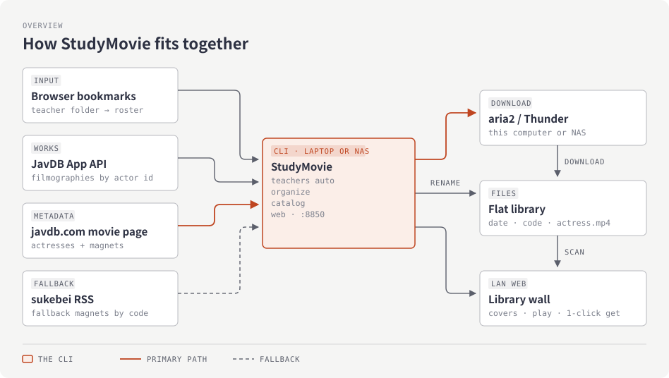
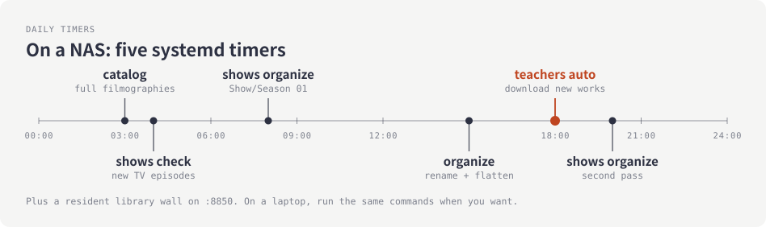
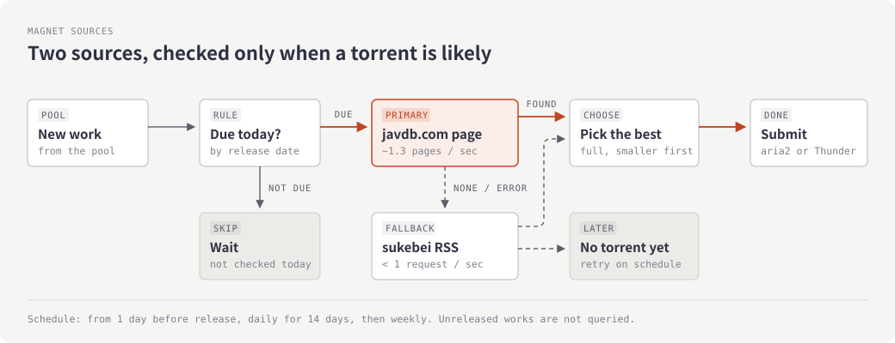
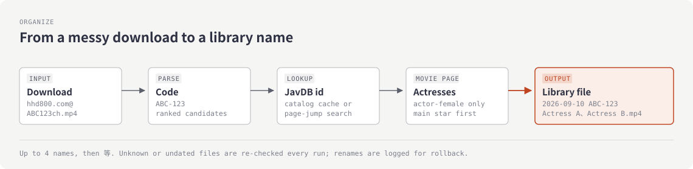
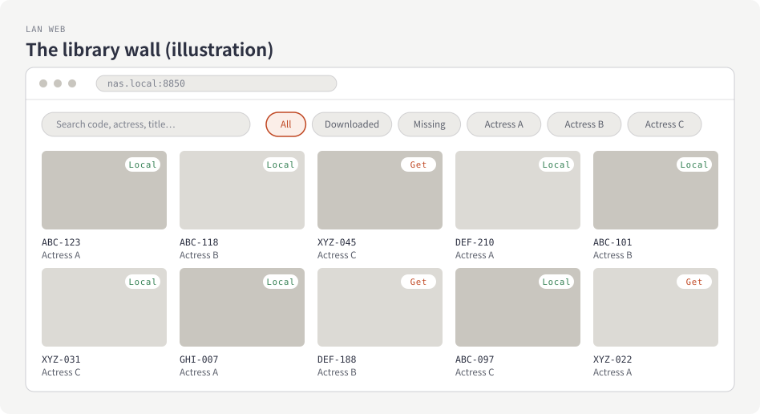

# StudyMovie: auto-download new JAV releases from JavDB and organize the library

**StudyMovie is a self-hosted command-line tool that keeps an automatic JAV library on your own computer or a home NAS.** It follows the actresses you bookmark, finds their new releases on JavDB, downloads the best magnet with aria2 (BitTorrent, any computer) or Thunder (迅雷, on a NAS), renames every finished file to `YYYY-MM-DD CODE Actress.ext`, and serves a LAN web wall of what you have and what you are missing. It also subscribes to TV series and anime and files episodes into `Show/Season 01/`.

[简体中文](README.md) · English


<p align="center"></p>

## At a glance

| | |
|---|---|
| **What it is** | A TypeScript CLI and one small web server; on a NAS, also five systemd user timers |
| **Who it is for** | Anyone who wants new releases of followed actresses to download and file themselves, on a laptop or on a NAS |
| **Download backends** | aria2 on this computer (default; started automatically) or Thunder (迅雷) on a NAS over SSH |
| **Input** | A browser bookmark folder of actress pages (Edge or Chrome format) |
| **Output** | A flat, date-sorted library: `2026-09-10 ABC-123 Actress A、Actress B.mp4` |
| **Metadata** | JavDB public app endpoints and javdb.com movie pages, no account or login |
| **Magnets** | javdb.com movie page first, sukebei RSS as fallback |
| **Runtime** | Node.js 18+, no runtime npm packages |
| **Measured** | Full deploy in about 2 minutes; daily auto run in about 1 minute for a pool of ~570 works; re-checking a 380-file library from cache in 1.4 s |

## Why does it exist?

Following 60+ actresses by hand means checking every profile, finding a magnet, starting a download and renaming the file. StudyMovie does that every day at 18:00 and keeps doing it when sources change: when JavDB put its search, detail and magnet endpoints behind login in November 2026, the tool switched to endpoints and pages that need no account, and it now exits non-zero when a source fails instead of reporting a silent "success".

## Features

- **Follow actresses, not files.** Bookmark an actress page and her new releases are queued automatically. Actress IDs are pinned in a roster file, so renamed or aliased names keep working.
- **Download where you are.** On a laptop or desktop it drives aria2 (starts the daemon itself, resumes after restarts, stops seeding when done). On a NAS it drives Thunder.
- **Two magnet sources with a schedule.** Works are queried from one day before release, daily for 14 days, then weekly. Unreleased works cost no requests.
- **Picks the sensible release.** Full releases over samples, original over AI "reducing mosaic" edits, seeded over dead, smaller non-HD first.
- **Library organizer.** Parses messy names such as `hhd800.com@ABC123ch.mp4`, looks up the female cast, writes all co-stars (up to four, then `等`), and moves leftovers to a trash folder with a rollback log.
- **LAN library wall.** Covers, search, filter by actress, play in the browser, and one-click download for works you are missing.
- **TV and anime subscriptions.** Searches through Jackett, downloads new episodes and archives them as `Show/Season 01/Show - S01E03.mkv` for Jellyfin.
- **Fails loudly.** Any failed source or submission makes the run exit 1, so `systemctl --user status` shows the problem the same day.

## How does it work?

### Daily schedule

<p align="center"></p>

### Where do magnets come from?

<p align="center"></p>

Both sources are rate-limited, so each HTTP client paces itself: javdb.com pages at one request per 0.8 s (more than about 1.5 per second returns HTTP 429), sukebei at one per 1.3 s. Work is checked in small parallel batches so the two sources wait at the same time.

### How are files named?

<p align="center"></p>

The JavDB id comes from the local catalog when it is known; otherwise the tool jumps through the code's release list by number distance (2–4 requests instead of paging from the start). Results are cached, so later runs read the cache and send no requests.

### The library wall

<p align="center"></p>

## Use it from an AI agent

StudyMovie ships an [agent skill](skills/studymovie/SKILL.md). Paste this into Claude Code, Codex, Cursor or any other coding agent:

> Install StudyMovie from https://github.com/OceanJy333/StudyMovie: follow skills/studymovie/SKILL.md, then run `studymovie doctor`.

To give the agent the skill permanently, add it with the open [skills](https://github.com/vercel-labs/skills) installer:

```bash
npx skills add OceanJy333/StudyMovie
```

The agent then installs the CLI locally (`npm install -g --install-links github:OceanJy333/StudyMovie`), asks whether to download on this computer or on a NAS, and maps requests such as "download ABC-123" or "what is the NAS downloading?" to commands. It always shows the plan before it adds `--apply`.

## Quick start

### On your own computer (aria2)

You need Node.js 18+ and [aria2](https://aria2.github.io/) (`brew install aria2`, `sudo apt install aria2` or `winget install aria2.aria2`).

```bash
npm install -g --install-links github:OceanJy333/StudyMovie
mkdir -p ~/.config/nas-movie
echo 'NAS_MOVIE_ARCHIVE=/path/to/library' >> ~/.config/nas-movie/env
studymovie doctor
studymovie teachers auto --numbers ABC-123 --apply
```

No `config.json` is needed. The first download starts an `aria2c` daemon on `127.0.0.1:6800`; it keeps downloading after the command exits and resumes after a restart. `studymovie status` shows progress, and `studymovie organize --apply` renames finished files. To use an aria2 you already run (Motrix, a seedbox), put `{"downloader": "aria2", "aria2": {"rpc": "http://host:6800/jsonrpc", "secret": "…"}}` in `~/.config/nas-movie/config.json`.

### On a NAS (Thunder and timers)

- A Linux NAS with SSH access and systemd user services (tested on UGREEN UGOS, Debian based).
- Thunder (迅雷) for NAS with its local API on `127.0.0.1:5050`.
- Node.js 18 or newer on the NAS; Node.js 22.6+ on the machine you build from.
- Optional: an HTTP proxy on the NAS (mihomo/clash) if javdb.com or sukebei is blocked on your network; Jackett for movie and TV search.

Install from source and deploy the timers:

```bash
git clone https://github.com/OceanJy333/StudyMovie.git
cd StudyMovie
npm install
npm test
```

```bash
mkdir -p ~/.config/nas-movie
cp config.example.json ~/.config/nas-movie/config.json
cp env.example ~/.config/nas-movie/env
```

Edit both files, then deploy. The script builds `dist/`, uploads it, installs the timers and runs a dry run of each job:

```bash
./deploy-nas.sh
```

### Try it without changing anything

Every command prints a plan as JSON until you add `--apply`:

```bash
npm run movie -- teachers auto
npm run movie -- organize
```

## Commands

| Command | What it does |
|---|---|
| `teachers auto [--apply] [--days 30]` | Pool all followed actresses' recent works and download the ones that now have a torrent |
| `teachers backfill [--apply] [--limit 100]` | One-off: fill the library with the newest N works across all actresses |
| `teachers names --save roster.json` | Export the bookmark folder and pin each actress to a JavDB id |
| `catalog [--pages 8]` | Fetch full filmographies so the wall can show what you have not downloaded |
| `organize [--apply]` | Flatten finished downloads into the library and rename them |
| `web [--port 8850]` | Serve the LAN library wall |
| `shows add <name> --query "..."` / `shows check --apply` / `shows organize --apply` | TV and anime subscriptions |
| `status`, `add <magnet>`, `doctor` | Download tasks, manual add, health check (`paths` lists Thunder folders) |
| `search` / `resources` / `fetch <title> --year 2020` | Movie search through Jackett with seed, quality and size ranking |

## Configuration

Personal settings live in `~/.config/nas-movie/env` (see [`env.example`](env.example)); connection details in `~/.config/nas-movie/config.json` (see [`config.example.json`](config.example.json)). Real environment variables take precedence over the file.

| Variable | Default | Meaning |
|---|---|---|
| `NAS_SSH` | (required for deploy) | ssh config host of the NAS |
| `NAS_MOVIE_ARCHIVE` | `~/Media/JAV` | Flat JAV library and default download folder |
| `NAS_MOVIE_SHOWS_ROOT` | `~/Media/Shows` | TV / anime library |
| `NAS_MOVIE_TRASH` | `~/.nas-movie-trash` | Where organize moves leftovers |
| `NAS_MOVIE_BOOKMARKS_HOST` | empty (local) | ssh host that holds the browser bookmarks |
| `NAS_MOVIE_BOOKMARKS_FILE` | Edge default path | Bookmarks file |
| `NAS_MOVIE_BOOKMARKS_FOLDER` | `Teachers` | Bookmark folder with actress pages |
| `NAS_MOVIE_PROXY` | none (deploy sets `http://127.0.0.1:7890`) | HTTP proxy for javdb.com and sukebei |

State files (roster, download ledger, metadata cache, rename log) live under `~/.config/nas-movie/state/` on the NAS.

## FAQ

### Does StudyMovie need a JavDB account?

No. It uses JavDB app endpoints that are still public (actor filmographies, maker and code lists, actor profiles) and the public javdb.com movie page for cast and magnets. Logging in was rejected on purpose: tokens expire and would become a new single point of failure.

### What happens when a source starts blocking requests?

The run exits with code 1 and the summary line names what failed, for example `失败 2（ABC-123 磁力查询…）`. A page that is not a movie page (a challenge page or a redesign) is treated as an error, never as "no actresses" or "no magnets".

### How does it decide which torrent to download?

From sukebei it keeps only torrents whose name contains the full code (so `ABC-123` never matches `ABC-1230`), prefers seeded ones and skips AI "reducing mosaic" edits when an original exists. Across both sources it prefers full releases of at least 400 MB, then non-HD, then the smaller file.

### Will it rename files I already have?

Only files already in the `YYYY-MM-DD CODE Actress.ext` format at the library root are re-checked, and only renamed when the result changes (for example an unknown actress is now known, or co-stars were added). Every move is logged in `state/organized.json` with its original path.

### Can I use it without a NAS?

Yes. Without a `config.json` the CLI downloads with aria2 on the machine it runs on, and the organizer and web wall work on any folder. Only the deploy script and its systemd timers are NAS-specific; on a laptop, run `teachers auto --apply` when you want, or schedule it yourself. macOS is tested; Linux should behave the same; Windows is untested.

### How is it different from Movie_Data_Capture, JavSP and other scrapers?

Scrapers add metadata to files you already have; StudyMovie finds new releases, downloads them and names them. The two can be used together.

| | Metadata scrapers | StudyMovie |
|---|---|---|
| Finds new releases of followed actresses | No | Yes, daily |
| Starts downloads | No | Yes, aria2 or Thunder |
| Renames into a flat library | Yes | Yes, with all co-stars |
| Writes NFO files and posters for media servers | Usually | No, the file name is the metadata |
| Runs unattended on the NAS | Rarely | Yes, systemd timers |

## Project layout

```text
src/
  teachers/   roster, pool, daily selection and submission
  javdb/      JavDB app client, web page adapter, magnet rules
  sukebei.ts  sukebei RSS adapter
  library/    code parsing, naming, metadata cache, organize
  catalog/    full filmography catalog for the wall
  web/        LAN library wall server and views
  shows/      TV and anime subscriptions
  core/       HTTP client (proxy, pacing, deadlines), paths, JSON, async helpers
skills/       agent skill (SKILL.md) for Claude Code, Codex and other agents
docs/         README figures (regenerate with python3 docs/figures.py)
deploy-nas.sh build, upload, install timers, dry run
```

## Development

```bash
npm run check   # tsc --noEmit
npm test        # node --test, 81 tests
npm run build   # dist/ for the NAS
```

## License

[MIT](LICENSE)
