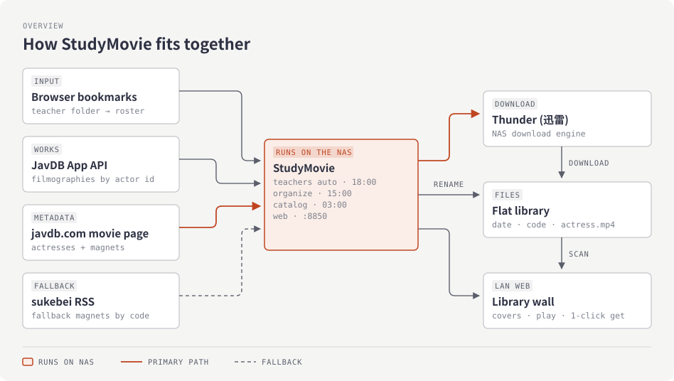
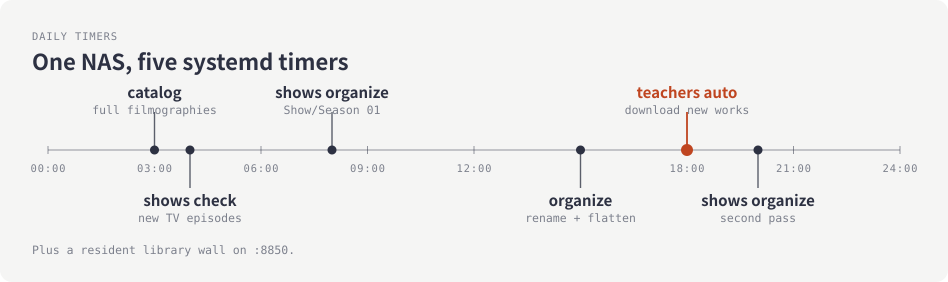
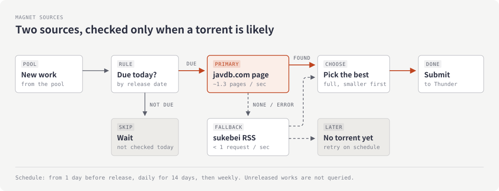
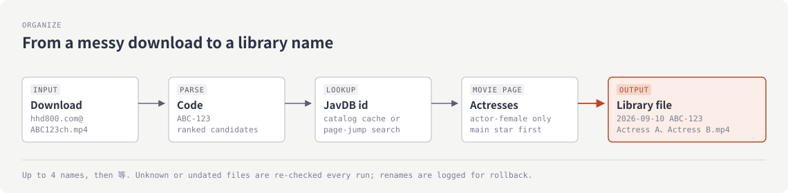
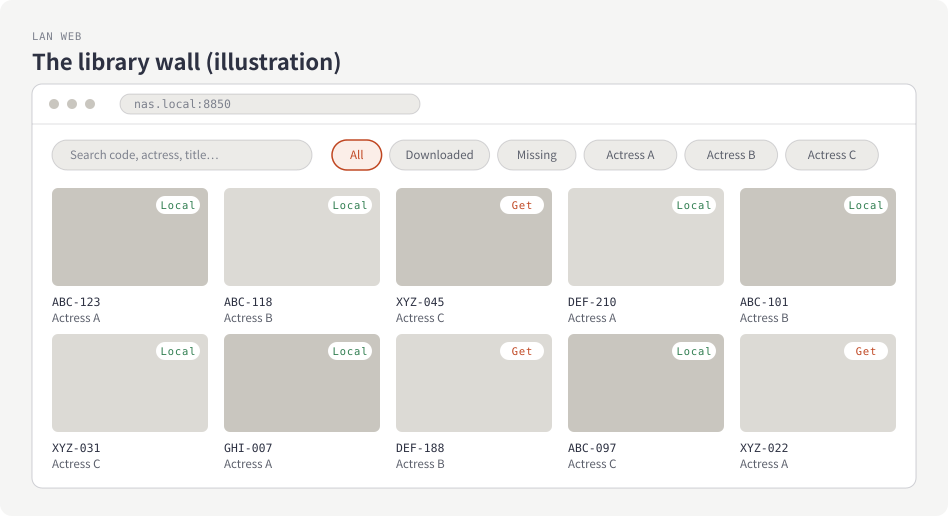

# StudyMovie

**StudyMovie 是一个自托管的命令行工具，把家里的 NAS 变成自动更新的 JAV 片库。** 你在浏览器里收藏演员页，它每天去 JavDB 找这些演员的新作，把最合适的磁力交给 NAS 上的迅雷下载，下完后把文件统一命名成 `发行日期 番号 演员.ext`，再在局域网里提供一面影片墙，显示已有和缺少的作品。它也能订阅电视剧和番剧，下完按 `剧名/Season 01/` 归档。

[English](README.md) · [简体中文](README.zh-CN.md)


<p align="center"></p>

## 一览

| | |
|---|---|
| **是什么** | 一个 TypeScript CLI，加 5 个 systemd 用户定时任务和一个小型 Web 服务，全部跑在 NAS 上 |
| **适合谁** | NAS 上装了迅雷（如绿联 UGOS），想让关注演员的新作自动下载、自动归档的人 |
| **输入** | 浏览器书签里的一个演员页文件夹（Edge / Chrome 格式） |
| **输出** | 平铺、按日期排序的片库：`2026-09-10 ABC-123 演员甲、演员乙.mp4` |
| **元数据** | JavDB 仍公开的 App 接口和 javdb.com 影片网页，不需要账号 |
| **磁力** | 先取 javdb.com 影片页上的磁力，没有再查 sukebei RSS |
| **NAS 上的运行环境** | Node.js 18+，不装 npm 依赖（只部署 `dist/`） |
| **实测** | 完整部署约 2 分钟；约 570 部作品的池子，每日任务约 1 分钟；380 个文件的片库用缓存重算一次 1.4 秒 |

## 为什么做这个？

手动跟 60 多位演员，意味着要逐个看主页、找磁力、开下载、改文件名。StudyMovie 每天 18:00 做这件事，数据源变了也能继续工作：2026 年 11 月 JavDB 把搜索、详情和磁力接口都改成要登录，工具换成了不需要账号的接口和网页；现在只要有数据源失败，任务就以非零状态退出，不会再"成功"地什么都没下。

## 功能

- **跟人，不跟文件。** 收藏演员页，她的新作就会自动排进下载。演员 id 固化在名册文件里，改名、别名都不受影响。
- **双磁力来源，按日程查询。** 从发行前一天开始查，发行后两周每天查，之后每周查一次。没发行的作品不发请求。
- **挑合适的版本。** 完整版优先于样片，原版优先于 AI 去码版，有做种的优先，非高清、体积小的优先。
- **片库整理。** 能解析 `hhd800.com@ABC123ch.mp4` 这类乱名，查出全部女演员（最多写 4 位，再多加「等」），种子和广告挪进回收目录，每次移动都记账可回滚。
- **局域网影片墙。** 封面、搜索、按演员筛选、浏览器内播放，没下的作品一键下载。
- **剧集和番剧订阅。** 通过 Jackett 搜索新集，提交迅雷，下完按 `剧名/Season 01/剧名 - S01E03.mkv` 归档，Jellyfin 直接识别。
- **出错就报错。** 任何数据源或提交失败，任务都以退出码 1 结束，当天就能在 `systemctl --user status` 里看到。

## 怎么工作？

### 每天的定时任务

<p align="center"></p>

### 磁力从哪来？

<p align="center"></p>

两个来源都有限流，所以每个 HTTP 客户端自己控制节奏：javdb.com 影片页每 0.8 秒一次（超过约每秒 1.5 次会返回 429），sukebei 每 1.3 秒一次。查询按小批并发，两个来源的等待时间能重叠。

### 文件怎么命名？

<p align="center"></p>

JavDB id 优先用本地作品目录里记过的；没有时按番号差在同前缀片单里跳页查找，一般 2–4 次请求，不用从头翻。结果会缓存，之后每轮只读缓存，不再请求。

### 影片墙

<p align="center"></p>

## 交给 AI agent 用

StudyMovie 自带一个 [agent skill](skills/studymovie/SKILL.md)。把下面这句话发给 Claude Code、Codex、Cursor 或其他编程 agent：

> 从 https://github.com/OceanJy333/StudyMovie 安装 StudyMovie：按 skills/studymovie/SKILL.md 操作，最后运行 `studymovie doctor`。

想让 agent 长期带着这个 skill，可以用开源的 [skills](https://github.com/vercel-labs/skills) 安装器添加：

```bash
npx skills add OceanJy333/StudyMovie
```

agent 会把 CLI 装到本机（`npm install -g --install-links github:OceanJy333/StudyMovie`），向你要 NAS 和迅雷的设置，再把"下载 ABC-123""NAS 在下什么"这类请求翻成命令。它总是先给出计划，再加 `--apply` 执行。

## 快速开始

### 需要什么

- 能 SSH 登录、支持 systemd 用户服务的 Linux NAS（在绿联 UGOS 上验证过，基于 Debian）。
- NAS 版迅雷，本机接口在 `127.0.0.1:5050`。
- NAS 上 Node.js 18 或更新；构建用的电脑上 Node.js 22.6+。
- 可选：网络访问不了 javdb.com 或 sukebei 时，NAS 上需要一个 HTTP 代理（mihomo / clash）；搜电影和剧集需要 Jackett。

### 在电脑上安装 CLI

```bash
npm install -g --install-links github:OceanJy333/StudyMovie
studymovie --help
```

CLI 通过 SSH 连 NAS，不装定时任务也能在笔记本上直接用。

### 从源码安装并部署定时任务

```bash
git clone https://github.com/OceanJy333/StudyMovie.git
cd StudyMovie
npm install
npm test
```

```bash
mkdir -p ~/.config/nas-movie
cp config.example.json ~/.config/nas-movie/config.json
cp env.example ~/.config/nas-movie/env
```

改好这两个文件后部署。脚本会构建 `dist/`、上传、安装定时任务，并把每个任务 dry-run 一遍：

```bash
./deploy-nas.sh
```

### 先看计划，不动任何东西

不加 `--apply` 时，每个命令只输出 JSON 计划：

```bash
npm run movie -- teachers auto
npm run movie -- organize
```

## 命令

| 命令 | 作用 |
|---|---|
| `teachers auto [--apply] [--days 30]` | 把所有关注演员的近期作品放进一个池，已经有种子的就下载 |
| `teachers backfill [--apply] [--limit 100]` | 一次性补齐：所有演员合起来最新的 N 部 |
| `teachers names --save roster.json` | 导出书签文件夹，给每位演员固定 JavDB id |
| `catalog [--pages 8]` | 抓完整片单，影片墙才能显示没下的作品 |
| `organize [--apply]` | 把下载完的片子平铺进片库并改名 |
| `web [--port 8850]` | 启动局域网影片墙 |
| `shows add <名字> --query "..."` / `shows check --apply` / `shows organize --apply` | 剧集和番剧订阅 |
| `status`、`paths`、`add <magnet>`、`doctor` | 迅雷任务、下载目录、手动添加、健康检查 |
| `search` / `resources` / `fetch <片名> --year 2020` | 通过 Jackett 搜电影，按做种、画质、体积排序 |

## 配置

个人设置放在 `~/.config/nas-movie/env`（见 [`env.example`](env.example)），连接信息放在 `~/.config/nas-movie/config.json`（见 [`config.example.json`](config.example.json)）。真实环境变量优先于文件。

| 变量 | 默认值 | 含义 |
|---|---|---|
| `NAS_SSH` | 部署时必填 | NAS 在 ssh config 里的主机名 |
| `NAS_MOVIE_ARCHIVE` | `~/Media/JAV` | 平铺片库，也是迅雷默认下载目录 |
| `NAS_MOVIE_SHOWS_ROOT` | `~/Media/Shows` | 剧集和番剧库 |
| `NAS_MOVIE_TRASH` | `~/.nas-movie-trash` | 整理时挪走的残留文件 |
| `NAS_MOVIE_BOOKMARKS_HOST` | 空（本机） | 书签所在电脑的 ssh 主机名 |
| `NAS_MOVIE_BOOKMARKS_FILE` | Edge 默认路径 | 书签文件 |
| `NAS_MOVIE_BOOKMARKS_FOLDER` | `Teachers` | 放演员页的书签文件夹 |
| `NAS_MOVIE_PROXY` | 无（部署脚本设为 `http://127.0.0.1:7890`） | 访问 javdb.com 和 sukebei 的 HTTP 代理 |

状态文件（名册、下载账本、元数据缓存、改名记录）在 NAS 的 `~/.config/nas-movie/state/` 下。

## 常见问题

### 需要 JavDB 账号吗？

不需要。它用 JavDB 仍然公开的 App 接口（演员片单、厂牌和番号前缀列表、演员资料），演员和磁力取自公开的 javdb.com 影片页。没有选择登录：token 会过期，会成为新的故障点。

### 数据源开始拦截请求会怎样？

任务以退出码 1 结束，汇总行会点名失败项，例如 `失败 2（ABC-123 磁力查询…）`。拿到的不是影片页（挑战页、改版）一律算错误，不会当成"没有演员"或"没有磁力"。

### 怎么决定下哪个种子？

sukebei 的结果只保留名字里有完整番号的（`ABC-123` 不会误中 `ABC-1230`），有做种的优先，有原版时不选 AI 去码版。两个来源合起来，优先 400 MB 以上的完整版，再优先非高清，再优先体积小的。

### 会改我已有的文件吗？

只会重查片库根目录里已经是 `发行日期 番号 演员.ext` 格式的文件，名字有变化才改（比如未知演员认出来了，或补上了共演者）。每次移动都记在 `state/organized.json`，带原路径。

### 没有 NAS 能用吗？

CLI 在任何装了 Node.js 的机器上都能跑，但下载依赖 NAS 版迅雷的接口，定时任务是 systemd 用户服务。片库整理和影片墙对任意目录都能用。

### 和元数据刮削工具有什么不同？

| | 元数据刮削工具 | StudyMovie |
|---|---|---|
| 发现关注演员的新作 | 否 | 是，每天 |
| 发起下载 | 否 | 是，通过迅雷 |
| 改名成平铺片库 | 是 | 是，写全共演者 |
| 给媒体服务器写 NFO 和海报 | 通常会 | 否，文件名就是元数据 |
| 在 NAS 上无人值守运行 | 少见 | 是，systemd 定时任务 |

## 目录结构

```text
src/
  teachers/   名册、作品池、每日挑选和提交
  javdb/      JavDB App 客户端、网页适配器、磁力规则
  sukebei.ts  sukebei RSS 适配器
  library/    番号解析、命名、元数据缓存、整理
  catalog/    影片墙用的完整作品目录
  web/        局域网影片墙服务和页面
  shows/      剧集和番剧订阅
  core/       HTTP 客户端（代理、节流、超时）、路径、JSON、并发工具
skills/       给 Claude Code、Codex 等 agent 用的 skill（SKILL.md）
docs/         README 插图（用 python3 docs/figures.py 重新生成）
deploy-nas.sh 构建、上传、安装定时任务、dry-run
```

## 开发

```bash
npm run check   # tsc --noEmit
npm test        # node --test，77 项
npm run build   # 生成给 NAS 用的 dist/
```

## 许可证

[MIT](LICENSE)
